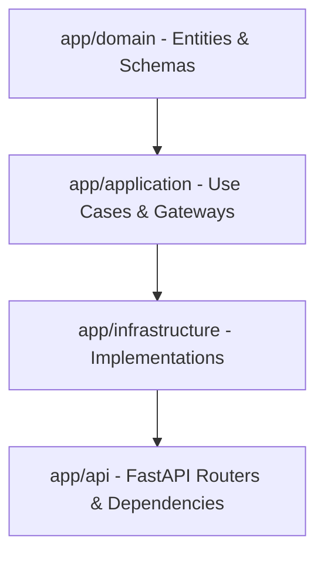

# GEMINI.md - AI Agent Instruction Manual & Repository Guide

> This file contains the instructions, architectural standards, and development rules for any AI agent pair-programming in the `gnosis-chat-backend` repository. Read this file carefully before making any code modifications.

---

## 🎯 Repository Overview

`gnosis-chat-backend` is an Agentic RAG (Retrieval-Augmented Generation) pipeline built on top of **FastAPI** and **LangGraph** (Python 3.12+). Its core purpose is to provide deep, solene, and extremely faithful esoterical responses based on a loaded corpus of PDFs (stored in Qdrant) with strict citation tracing.

---

## ⚙️ Architecture & Design System

The repository follows a strict **Clean Architecture** pattern to isolate dependencies and business logic:



1. **`app/domain`**: Domain schemas (Pydantic), exceptions, and entities.
2. **`app/application`**: Interfaces (Gateways) and Use Cases (`ask_rag_use_case.py`, etc.).
3. **`app/infrastructure`**: Concrete implementations of databases (Supabase), search engines (Qdrant), and LLM interfaces (Google Gemini).
4. **`app/api`**: FastAPI endpoints, routers, and request/response models.

---

## 🤖 The Agentic LangGraph Pipeline

The core logic runs inside a LangGraph state machine. It coordinates several specialized nodes:

*   **`orchestrator`**: Decides whether the query needs deep document search, a direct response, or human-in-the-loop (HIL) clarification.
*   **`researcher`**: Fetches relevant chunks from the Qdrant local vector database and applies reranking.
*   **`critique`**: Evaluates whether the retrieved chunks are sufficient to answer the query. Has loop-protection guardrails.
*   **`writer`**: Formulates the final response using markdown and strict inline citations (`[Book, p. X]`).
*   **`judge`**: Audits the written response against the retrieved source chunks to prevent hallucinations.
*   **`recap`**: Generates a brief summary of the conversation state.

---

## 🔴 CRITICAL RULES FOR AI AGENTS (Read Before Coding)

### 1. 🚫 NO UVLOOP (Asyncio Only)
*   **Context**: The `google-genai` SDK uses internal gRPC/threading models that deadlock and hang indefinitely under `uvloop` on Linux.
*   **Rule**: **Do not install `uvloop`** or add it to `pyproject.toml`. Uvicorn must run using Python's default `asyncio` event loop policy.
*   **Start Command**: Always use `uv run uvicorn app.main:app --reload` (which will fall back to native asyncio since uvloop is not installed).

### 2. ⚡ Native Async for Google SDK
*   **Rule**: When interacting with the Gemini API via the `google-genai` SDK, always use the native async API under `client.aio`:
    ```python
    # CORRECT:
    response = await self.client.aio.models.generate_content(...)
    
    # WRONG:
    response = await loop.run_in_executor(None, lambda: self.client.models.generate_content(...))
    ```

### 3. 🔒 Qdrant Local Exclusive Locking
*   **Context**: The backend uses Qdrant in local storage mode (`data/qdrant_db`). Local mode places an exclusive file lock (`fcntl`) on the database directory.
*   **Rule**: **Do not instantiate multiple Qdrant clients concurrently.** The gateway `QdrantVectorStore` must be managed as a **Singleton** in FastAPI dependency injection (`get_vector_store_gateway` in `chat.py`) to prevent `portalocker.exceptions.AlreadyLocked` crashes.
*   **Rule**: Avoid running multiple Uvicorn instances (e.g. one on port 8000 and another on 8080) simultaneously as they will fight for the Qdrant database lock.

### 4. 🌐 Local Offline / Supabase Mocking
*   **Rule**: When working in a local development environment (`APP_ENV=development`), the backend gracefully mocks Supabase database interactions if the database is unreachable (e.g., VPN issues or project paused). 
*   **Rule**: When writing database calls, ensure they fail gracefully by catching network exceptions (like `[Errno -2] Name or service not known`) and return a mock/default UUID instead of throwing a 500 error.

### 5. 📚 Estrita Fidelidade e Citações (Strict Source Fidelity)
*   **Rule**: The AI must not invent or presume facts. If the retrieved context does not contain the answer, the writer must decline to answer and ask the user to provide the source pages.
*   **Rule**: Every assertion must be cited in the text using `[Nome do Livro, p. X]`.

---

## 🧪 Testing and Diagnostics

Before committing any feature or refactoring the graph, run the following command to test the graph end-to-end without starting the FastAPI server:

```bash
uv run scratch/test_full_graph.py
```

To test the FastAPI API stream layer:

```bash
uv run scratch/test_api_endpoint.py
```
