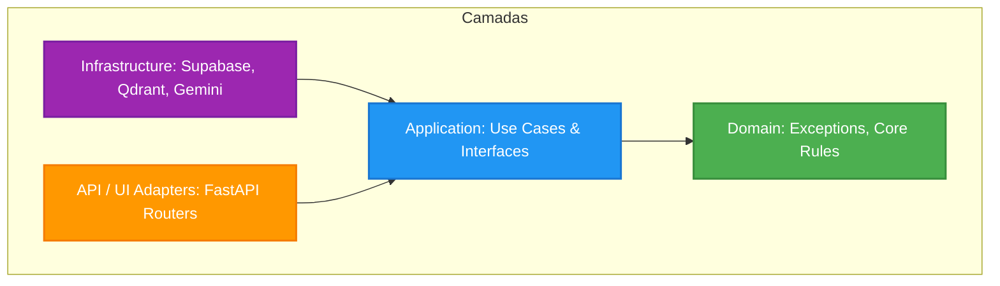

# Clean Architecture no Gnosis Chat Backend

Este documento descreve os princípios fundamentais da **Clean Architecture** (Arquitetura Limpa) e detalha como eles foram refletidos no design de software e na organização de arquivos da API do **Gnosis Chat**.

---

## 1. O que é Clean Architecture?

Proposta por Robert C. Martin (Uncle Bob), a **Clean Architecture** é uma filosofia de design que visa à **separação de preocupações (Separation of Concerns)**. O principal objetivo é isolar a lógica de negócio central da aplicação (as regras de negócio) de detalhes técnicos, como:
* O framework web (FastAPI, Flask)
* O banco de dados (PostgreSQL, Supabase)
* O provedor de busca vetorial (Qdrant, Pinecone)
* APIs externas de IA (Google Gemini, OpenAI, Vertex AI)

### A Regra de Dependência (Dependency Rule)

No centro da arquitetura estão as regras de domínio. À medida que nos movemos para fora dos círculos concêntricos, o nível de detalhe técnico aumenta. 

> [!IMPORTANT]
> **A regra fundamental:** As dependências de código devem apontar apenas **para dentro**. Uma camada interna não pode saber absolutamente nada sobre nenhuma camada mais externa.



---

## 2. Como a Arquitetura foi Refletida no Projeto

A estrutura de diretórios do repositório `gnosis-chat-backend/app/` foi totalmente organizada de forma a espelhar as camadas da Clean Architecture:

```text
app/
├── domain/                  # Camada 1: Lógica de negócio e exceções fundamentais
├── application/             
│   ├── interfaces/          # Camada 2: Contratos e Gateways abstratos
│   └── use_cases/           # Camada 2: Orquestradores de regras de uso da aplicação
├── infrastructure/          # Camada 3: Adaptadores de banco, vetores, LLM e checkpointers
├── api/                     # Camada 4: Rotas FastAPI (Apresentadores)
└── agents/                  # LangGraph: State, nós especialistas e topologia de grafo
```

### Camada 1: Domain
Contém os objetos de domínio fundamentais e exceções de negócio independentes de transporte ou banco.
* **Reflexão no Projeto:** `exceptions.py`. A exceção `QuotaExceededException` define a regra de estouro de cota e é disparada pelas regras de negócio da aplicação sem depender de status HTTP do FastAPI.

### Camada 2: Application (Use Cases & Interfaces)
Esta camada contém as intenções do software (Use Cases) e os contratos abstratos de comunicação com o mundo externo (Interfaces).
* **Reflexão no Projeto - Interfaces:** No diretório `interfaces/` definimos os contratos abstratos:
  * `LLMGateway`: Apenas declara métodos como `generate_text` ou `generate_json`.
  * `VectorStoreGateway`: Apenas declara `search_books`.
* **Reflexão no Projeto - Use Cases:** O `AskRagUseCase` coordena as regras de limite (UC09) e a chamada ao grafo LangGraph. Ele depende exclusivamente de **abstrações (Interfaces)** e não de implementações concretas (inversão de dependência).

### Camada 3: Infrastructure (Adapters)
Contém os detalhes tecnológicos de baixo nível. É onde estão as bibliotecas externas e SDKs proprietários.
* **Reflexão no Projeto:** Os arquivos em `infrastructure/` implementam concretamente os contratos definidos na camada de aplicação:
  * `GeminiLLM` implementa `LLMGateway` usando o SDK `google-genai`.
  * `QdrantVectorStore` implementa `VectorStoreGateway` usando `QdrantClient`.

### Camada 4: API (Apresentadores)
Framework FastAPI que lida com requisições e respostas de rede.
* **Reflexão no Projeto:** O router `chat.py` apenas valida o payload HTTP (`ChatRequest`), pega o usuário autenticado, chama a injeção do Use Case e gerencia a transmissão em tempo real via **Server-Sent Events (SSE)**. Ele não tem nenhuma lógica de negócio ou RAG interna.

---

## 3. Benefícios Práticos Observados

### 1. Testabilidade sem Efeitos Colaterais (Mocks)
No arquivo `tests/test_rag_agentic.py`, nós conseguimos mockar todos os gateways herdando de suas respectivas interfaces. Isso nos permitiu testar toda a lógica do grafo de agentes e do HIL localmente com velocidade instantânea e **sem tocar na internet** ou em bases de dados reais:
```python
# Passamos os mocks via configuração dinâmica do LangGraph
config = {
    "configurable": {
        "llm": MockLLM(),
        "vector_store": MockVectorStore(),
        "database": MockDatabase()
    }
}
```

### 2. Flexibilidade Tecnológica
Se no futuro o projeto optar por:
1. Trocar a busca vetorial do **Qdrant** pelo **Pinecone** ou **PgVector**.
2. Substituir o modelo **Google Gemini** por **Anthropic Claude** ou **OpenAI GPT-4o**.

> [!TIP]
> **O custo de mudança é quase zero:** basta criar um novo adaptador na camada `infrastructure/` que herde da respectiva interface na camada `application/`. **Zero linhas de código do Use Case, das rotas FastAPI ou do grafo do LangGraph precisarão ser alteradas.**
