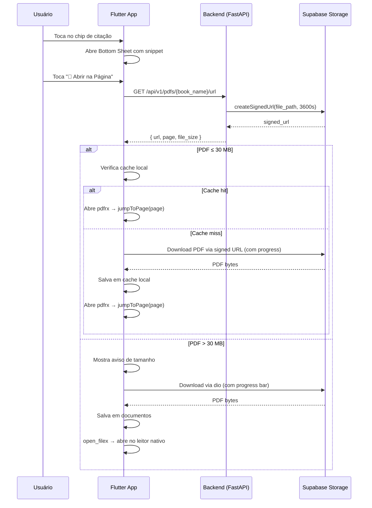

# 📄 Estudo: Botão "Abrir PDF na Página" — Viabilidade Técnica e Econômica

> **Projeto:** Gnosis Chat  
> **Data:** 2026-07-07  
> **Escopo:** Analisar a viabilidade, custo, impacto em performance e UX de adicionar um botão para abrir o PDF original na página exata da citação referenciada pelo RAG.

---

## 1. Inventário do Corpus (Dados Reais)

Antes de qualquer análise, precisamos entender o que estamos lidando:

| Métrica | Valor |
|---------|-------|
| **Total de PDFs** | 148 arquivos |
| **Tamanho total** | 502 MB |
| **Tamanho médio** | 3,39 MB por PDF |
| **Maior PDF** | 107 MB (*Los Misterios Ocultos del Divino Daimon*) |
| **Menor PDF** | 20 KB (*Mensaje de Navidad 1997*) |
| **PDFs > 50 MB** | 4 arquivos |
| **PDFs > 10 MB** | 6 arquivos |
| **Organização** | 2 pastas: `1a_camara/` e `2a_camara/` |

> [!IMPORTANT]
> A maioria dos PDFs (142 de 148) tem menos de 10 MB, o que é extremamente favorável para streaming via CDN. Os 4 outliers acima de 50 MB merecem atenção especial (ver Seção 5).

---

## 2. Armazenamento: Supabase Storage

### 2.1 Custos por Plano

| Recurso | Free | Pro ($25/mês) |
|---------|------|---------------|
| **Storage incluído** | 1 GB | 100 GB |
| **Tamanho máx. upload** | 50 MB | 500 GB |
| **Egress (não-cacheado)** | 5 GB | 250 GB |
| **Egress (cacheado/CDN)** | — | 250 GB |
| **Storage excedente** | Hard cap | $0.0213/GB/mês |
| **Egress excedente (uncached)** | — | $0.09/GB |
| **Egress excedente (cached)** | — | $0.03/GB |

### 2.2 Análise de Custo Real para o Gnosis Chat

**Storage:** 502 MB total. Cabe no plano Free (1 GB), mas considerando o restante do projeto, o plano Pro é mais adequado.

> [!NOTE]
> No plano Pro, 502 MB de PDFs consomem apenas **0,5%** dos 100 GB incluídos. Custo incremental de storage = **zero**.

**Egress (o fator crítico):**

Para estimar o egress, precisamos modelar o uso:

| Cenário | Usuários | Acessos PDF/dia | Tamanho médio | Egress/mês |
|---------|----------|-----------------|---------------|------------|
| **MVP (início)** | 50 | 2 por usuário | 3,4 MB | ~10 GB |
| **Crescimento** | 500 | 3 por usuário | 3,4 MB | ~153 GB |
| **Escala** | 2.000 | 3 por usuário | 3,4 MB | ~612 GB |

- **MVP:** 10 GB → Dentro do plano Pro (250 GB cached). Custo extra = **$0**.
- **Crescimento:** 153 GB → Ainda dentro do limite Pro com CDN. Custo extra = **$0**.
- **Escala:** 612 GB → Excede em ~112 GB. Custo extra ≈ **$3,36/mês** (cached).

> [!TIP]
> **Veredicto financeiro:** O custo de servir PDFs pelo Supabase Storage é desprezível. Mesmo em escala, estamos falando de ~$3/mês. Isso NÃO é um bloqueador.

### 2.3 Upload dos PDFs (Dashboard Setup & Script Execution)

To set up the Supabase Storage and upload the files, follow these steps:

#### Step 1: Create a Private Bucket in the Supabase Dashboard
1. Go to your **Supabase Dashboard** (https://supabase.com/dashboard).
2. On the left sidebar menu, click on the **Storage** icon (represented by a folder/box icon).
3. Click the **New bucket** button at the top of the Storage page.
4. Set the **Bucket Name** to `pdfs` (all lowercase, exactly matching our script configurations).
5. Ensure the **Public bucket** toggle is **OFF** (this ensures the bucket is **Private** and protected by RLS).
6. Click **Create bucket**.

#### Step 2: Running the Automation Script
We created a Python automation script under [upload_pdfs_and_seed.py](file:///home/walter/Documents/AI%20projects/Mobile/gnosis-chat-backend/scripts/upload_pdfs_and_seed.py) that handles the batch upload of all 148 PDFs, preserves the `1a_camara` and `2a_camara` folders, counts pages, and seeds the metadata database.

To execute it:
1. Ensure your `.env` contains the required keys:
   ```env
   SUPABASE_URL=https://your-project.supabase.co
   SUPABASE_SERVICE_ROLE_KEY=your-service-role-key-secret
   ```
2. Run the script using `uv` inside the backend directory:
   ```bash
   uv run python scripts/upload_pdfs_and_seed.py
   ```

---

## 3. Segurança: Signed URLs vs. Public Bucket

Como você mencionou que os PDFs não possuem direitos autorais restritos, temos duas opções:

| Aspecto | Public Bucket | Private + Signed URL |
|---------|--------------|---------------------|
| **Latência** | ⚡ Mínima (CDN cache direto) | ⚡ Igual (Smart CDN reconhece signed URLs) |
| **Cache hit rate** | Muito alto | Alto (Smart CDN otimizado) |
| **Segurança** | ❌ Qualquer um com a URL acessa | ✅ URL expira após N minutos |
| **Implementação** | Simples (URL pública fixa) | Requer endpoint no backend para gerar URL |
| **Custo extra** | Nenhum | Nenhum |
| **Risco** | Scraping em massa | Nenhum relevante |

### Recomendação: **Private Bucket + Signed URLs (1 hora de expiração)**

**Justificativa:** O Smart CDN do Supabase é otimizado para signed URLs e **não adiciona latência perceptível**. A segurança vem "de graça" sem custo de performance ou UX. Se alguém compartilhar o link, ele expira em 1 hora. Não é "super segurança", mas evita hotlinking e scraping trivial.

---

## 4. Opções de UX: Como o Usuário Lê o PDF

Existem 3 abordagens possíveis. Vou analisar cada uma criticamente:

### Opção A: Viewer In-App (pdfrx)

O usuário clica no botão da citação e o PDF abre **dentro do app** numa nova tela, diretamente na página referenciada.

| Aspecto | Avaliação |
|---------|-----------|
| **UX** | ⭐⭐⭐⭐⭐ Premium. O usuário não sai do app. |
| **Navegação para página** | ✅ `PdfViewerController.jumpToPage(N)` |
| **Performance** | ⚠️ Depende do tamanho do PDF |
| **Memória** | ⚠️ PDFs grandes (107 MB) podem causar OOM em devices modestos |
| **Dependência** | `pdfrx` (open source, motor PDFium, excelente) |
| **Peso no app** | +2-3 MB no bundle (motor PDFium nativo) |
| **Plataformas** | ✅ Android, iOS, Web, Desktop |

> [!WARNING]
> **Risco crítico:** Os 4 PDFs acima de 50 MB (especialmente o de 107 MB) podem causar **crashes de memória** em celulares com 2-3 GB de RAM. O `pdfrx` usa rendering virtualizado (carrega página por página), o que mitiga isso, mas o download inicial de 107 MB sobre 4G pode levar 30-60 segundos e travar a UI se não for feito em background.

**Mitigação:** Mostrar um loader com progresso de download e cachear localmente após o primeiro acesso.

### Opção B: Viewer Nativo Externo (open_filex)

O usuário clica no botão, o app baixa o PDF para o armazenamento local e abre no leitor de PDF padrão do dispositivo (Google PDF Viewer, Apple Books, etc.).

| Aspecto | Avaliação |
|---------|-----------|
| **UX** | ⭐⭐⭐ Funcional, mas sai do app. |
| **Navegação para página** | ❌ **Impossível.** `open_filex` não suporta parâmetro de página. O PDF abre na página 1. |
| **Performance** | ✅ O viewer nativo é altamente otimizado |
| **Memória** | ✅ Não impacta o app (outro processo) |
| **Dependência** | `dio` + `path_provider` + `open_filex` |
| **Peso no app** | Nenhum (usa apps já instalados) |
| **Download necessário** | Sim, sempre (não há como streamar para o viewer nativo) |

> [!CAUTION]
> **Problema fatal:** O objetivo principal é abrir **na página exata da citação**. Com `open_filex`, o PDF sempre abre na página 1. Isso destrói 80% do valor da feature. O usuário teria que navegar manualmente até a página 263 de um livro de 400 páginas — péssima UX.

### Opção C: Abordagem Híbrida (Recomendada ✅)

Combinar **Opção A** (in-app) como padrão + **botão de download** separado para quem quiser salvar o PDF e ler offline no app favorito.

| Componente | Implementação |
|------------|---------------|
| **Botão "📖 Abrir na Página"** | Abre viewer in-app (pdfrx) direto na página da citação |
| **Botão "⬇️ Baixar PDF"** | Baixa o arquivo e abre com `open_filex` no leitor nativo |
| **Cache local** | Após o primeiro download, o PDF é cacheado em `getApplicationDocumentsDirectory()` |
| **Loading UX** | Progress bar com % de download + tamanho do arquivo |

---

## 5. Impacto no App: O App Vai Ficar Pesado?

### 5.1 Tamanho do Bundle

| Componente | Impacto |
|------------|---------|
| **pdfrx** (motor PDFium) | +2-3 MB no APK/IPA |
| **open_filex** | +100 KB (leve) |
| **Lógica de download/cache** | ~200 linhas de Dart |
| **PDFs armazenados** | **Zero.** Tudo fica no Supabase, nada embutido no app |

> **Veredicto:** O app NÃO fica pesado. O aumento é de ~3 MB no bundle (de ~15 MB para ~18 MB), o que é insignificante. Os PDFs não são empacotados no app — são puxados sob demanda da CDN do Supabase.

### 5.2 Memória em Runtime

| Cenário | Memória estimada |
|---------|-----------------|
| **PDF pequeno (< 1 MB)** | +5-10 MB de RAM |
| **PDF médio (3 MB)** | +15-25 MB de RAM |
| **PDF grande (23 MB)** | +40-60 MB de RAM |
| **PDF gigante (107 MB)** | +100-150 MB de RAM ⚠️ |

**Estratégia para PDFs gigantes (> 50 MB):**

1. Exibir aviso: *"Este livro é grande (107 MB). Recomendamos baixá-lo para leitura offline."*
2. Oferecer apenas o botão de download para esses 4 PDFs, não o viewer in-app.
3. **Threshold sugerido:** PDFs > 30 MB → apenas download. PDFs ≤ 30 MB → viewer in-app + download.

### 5.3 Uso de Dados Móveis

| PDF médio | Rede | Tempo estimado |
|-----------|------|----------------|
| 3,4 MB | 4G (10 Mbps) | ~2,7 segundos |
| 3,4 MB | Wi-Fi (50 Mbps) | ~0,5 segundos |
| 23 MB | 4G | ~18 segundos |
| 107 MB | 4G | ~85 segundos |

> [!TIP]
> Com cache local, o PDF é baixado apenas **uma vez**. Acessos subsequentes são instantâneos (leitura do disco local).

---

## 6. Mapeamento PDF ↔ Citação & Criação da Tabela

O `CitationDraft` do backend já contém:
- `book_name` (nome do livro)
- `page` (número da página)
- `chamber` (câmara 1 ou 2)

### 6.1 Executando a Migração da Tabela `pdf_catalog`

Criamos a migration file [002_pdf_catalog.sql](file:///home/walter/Documents/AI%20projects/Mobile/gnosis-chat-backend/migrations/002_pdf_catalog.sql) com a estrutura correta.

Para criar a tabela no Supabase:
1. No seu **Supabase Dashboard**, clique em **SQL Editor** na barra lateral esquerda.
2. Clique em **New query**.
3. Copie e cole o conteúdo de [002_pdf_catalog.sql](file:///home/walter/Documents/AI%20projects/Mobile/gnosis-chat-backend/migrations/002_pdf_catalog.sql):
   ```sql
   CREATE TABLE pdf_catalog (
     id              UUID PRIMARY KEY DEFAULT gen_random_uuid(),
     book_name       TEXT NOT NULL UNIQUE,
     file_path       TEXT NOT NULL,
     chamber         INT NOT NULL DEFAULT 1 CHECK (chamber IN (1, 2)),
     author          TEXT DEFAULT 'Desconhecido',
     file_size_bytes BIGINT DEFAULT 0,
     page_count      INT DEFAULT 0,
     created_at      TIMESTAMPTZ NOT NULL DEFAULT now()
   );

   CREATE INDEX idx_pdf_catalog_book_name ON pdf_catalog(book_name);

   ALTER TABLE pdf_catalog ENABLE ROW LEVEL SECURITY;

   CREATE POLICY "Allow authenticated users to read pdf_catalog" ON pdf_catalog
     FOR SELECT TO authenticated USING (true);
   ```
4. Clique em **Run** no canto superior direito do editor SQL.

### 6.2 Como Popular a Tabela (Seeding)

A tabela é populada **automaticamente** em conjunto com o upload dos arquivos através do script `scripts/upload_pdfs_and_seed.py`. Ele calcula o número de páginas usando `pypdf`, mede o tamanho do arquivo em bytes, extrai o nome do autor e livro, e insere na tabela relacionando ao path do Storage.

---

## 7. Diagrama de Fluxo



---

## 8. Esforço de Implementação Estimado

| Tarefa | Complexidade | Tempo |
|--------|-------------|-------|
| Upload dos 148 PDFs para Supabase Storage | Baixa | 1-2h (script one-shot) |
| Criar tabela `pdf_catalog` + seed data | Baixa | 1h |
| Endpoint `GET /pdfs/{book}/url` no backend | Baixa | 1h |
| Tela de PDF Viewer com `pdfrx` no Flutter | Média | 3-4h |
| Sistema de cache local (download + check) | Média | 2h |
| Botão de download + `open_filex` | Baixa | 1h |
| Lógica de threshold (> 30 MB → download only) | Baixa | 30 min |
| Integração no Bottom Sheet de citação | Baixa | 1h |
| **Total** | | **~10-12h** |

---

## 9. Veredicto Final

### ✅ Vale a pena? **SIM, definitivamente.**

**Argumentos a favor:**

1. **Valor de UX gigantesco:** Poder clicar numa citação e ir direto ao trecho original no PDF é uma feature *killer*. Transforma o app de um chatbot genérico em uma **ferramenta de estudo real**.
2. **Custo financeiro irrisório:** ~$0/mês no início, ~$3/mês em escala. O Supabase Storage com CDN é absurdamente barato para esse volume.
3. **Não pesa o app:** Os PDFs ficam na nuvem. O app cresce ~3 MB (motor PDFium) e o cache local é gerenciado automaticamente.
4. **Dados já existem:** O `CitationDraft` já tem `book_name`, `page` e `chamber`. O mapeamento é direto.
5. **Diferencial competitivo:** Nenhum chat de IA gnóstico oferece isso. É premium de verdade.

**Riscos mitigáveis:**

1. ⚠️ **4 PDFs gigantes (50-107 MB):** Mitigado com threshold de download-only.
2. ⚠️ **Uso de dados móveis:** Mitigado com cache local (baixa uma vez, lê sempre).
3. ⚠️ **Latência no primeiro acesso:** Mitigado com progress bar e pré-fetch opcional.

### 📥 Botão de Download? **SIM, mas como ação secundária.**

O botão de download abre no leitor nativo do usuário. Ele não navega para a página, mas permite leitura offline no app preferido. É um complemento simples que agrega valor sem custo de implementação significativo.

---

## 10. Recomendação de Implementação

### Fase 1 — MVP (prioridade)
1. Upload PDFs → Supabase Storage (bucket privado)
2. Tabela `pdf_catalog` no Supabase
3. Endpoint de signed URL no backend
4. Viewer in-app com `pdfrx` (navega para a página)
5. Botão "Abrir na Página" no Bottom Sheet de citação

### Fase 2 — Polish
6. Cache local inteligente
7. Botão de download + `open_filex`
8. Threshold para PDFs gigantes
9. Progress bar com tamanho do arquivo

> [!NOTE]
> A Fase 1 pode ser implementada em **~6 horas** e já entrega 90% do valor da feature. A Fase 2 é polish e pode ser feita incrementalmente.

---

## 11. Status de Upload do MVP e Tratamento de Outliers (PDFs > 50 MB)

Durante o processo de upload em lote do MVP, foram identificados 4 arquivos que ultrapassaram o limite de **50 MB** do plano gratuito (Free Tier) do Supabase Storage:

1. **Los Misterios Ocultos del Divino Daimon** (106.47 MB)
2. **Os Sacramentos da Câmara Nupcial** (76.46 MB)
3. **Orientação Conjugal** (74.97 MB)
4. **Ele é Ele... Divino Daimon** (80.06 MB)

### Tratamento Adotado (Fallback)
* **Remoção do Banco:** Para evitar que o usuário tente abrir um arquivo que não existe no Storage, removemos os registros desses 4 livros da tabela `pdf_catalog`.
* **Comportamento no Frontend:** Quando o usuário tentar ler/baixar um desses 4 livros, a query de busca retornará `null`/vazio. O frontend deve capturar essa ausência de registro e mostrar uma mensagem amigável, como *"PDF ainda não disponível"*.

### Como subir estes PDFs no futuro?
Caso faça o upgrade para o plano Pro (que permite arquivos de até 500 GB) ou consiga comprimi-los para menos de 50 MB:
1. Verifique se os PDFs estão em suas respectivas pastas em `data/pdfs/`.
2. Execute o script exclusivo criado para os arquivos grandes para que você não precise processar todos os outros 166 novamente:
   ```bash
   uv run python scripts/upload_large_pdfs.py
   ```

